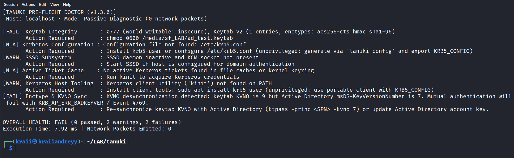
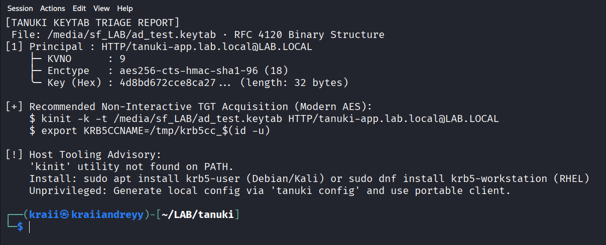
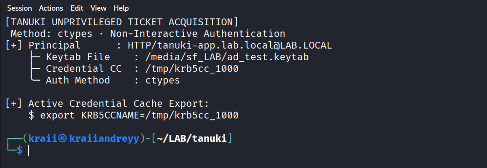
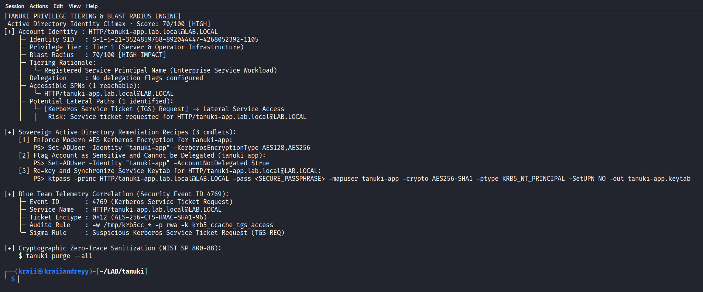

<p align="center">
  <picture>
    <source media="(prefers-color-scheme: dark)" srcset="assets/logo-dark.png">
    
  </picture>
</p>

<h1 align="center">Tanuki</h1>

<p align="center">
  <strong>Autonomous Non-Human Identity & Hybrid Active Directory Operator for Linux Workloads</strong><br>
  <em>Protocol-first, zero root privileges, zero host configuration footprint, zero noise.</em>
</p>

<p align="center">
  <a href="https://github.com/Mafifrizi/tanuki/actions"></a>
  
  
  
  
  
  
  <a href="https://youtu.be/7nGKrodNrlI"></a>
</p>

<p align="center">
  <a href="#overview">Overview</a> &bull;
  <a href="#quick-start">Quick Start</a> &bull;
  <a href="#dual-engine-architecture">Dual-Engine Architecture</a> &bull;
  <a href="#empirical-validation">Empirical Validation</a> &bull;
  <a href="#tooling--usage">Tooling & Usage</a> &bull;
  <a href="#the-decision-ladder">Decision Ladder</a> &bull;
  <a href="#repository-architecture">Architecture</a> &bull;
  <a href="#lineage--credits">Lineage & Credits</a>
</p>

---

## Overview

Modern cloud-native and on-premise environments increasingly run Linux workloads (Kubernetes pods, autonomous AI coding agents, CI/CD runners, containerized batch workers) that must authenticate to enterprise Active Directory domains without full domain join, Kerberos daemon daemons (`sssd`/`winbind`), or administrative root privileges.

**Tanuki** is an autonomous, protocol-first Active Directory operator designed specifically for unprivileged Linux userspace execution. It enforces complete Purple Team lifecycle parity: pre-flight triage, cryptographic ticket negotiation, quantitative privilege tiering, closed-loop self-healing, and forensic audit telemetry.

### Core Architectural Invariants

- **Living off the Domain (Zero Dependencies)**: The Python Reference Engine operates strictly on the Python 3.10+ standard library (`socket`, `struct`, `ctypes`, `hashlib`, `ssl`). Zero external pip packages are required.
- **Strictly Unprivileged Execution (UID 1000)**: Runs entirely in userspace. Never requires `sudo`, root privileges, or `CAP_SYS_TIME`.
- **Zero Host Mutation**: Never modifies `/etc/krb5.conf`, system PAM, or root system files. Configuration context is isolated strictly to the calling process and local in-memory session.
- **Dual-Engine Parity**: Maintained across both an accessible Python reference engine and a standalone, ultra-low latency Rust systems core (<0.96 ms execution, 1.8 MB statically linked musl binary).
- **In-Memory Clock Skew Self-Healing**: Automatically calculates and compensates for KDC time drift up to 420+ seconds directly in memory without modifying workstation system clocks.
- **Quantitative Blast Radius Engine**: Evaluates identity blast radius (0-100 score), classifies accounts into Active Directory tiers (Tier 0 / Tier 1 / Tier 2), and outputs deterministic PowerShell mitigation recipes for directory administrators.
- **Cryptographic Zero-Trace Memory Purge**: Implements NIST SP 800-88 cryptographic multi-pass zeroization across process memory, credential caches, and session artifacts.

---

## Quick Start

### 1-Line Universal Install

```bash
# Automated installer (detects Rust musl binary or falls back to Python standard engine)
curl -sSfL https://raw.githubusercontent.com/Mafifrizi/tanuki/main/install.sh | bash
```

### Manual Installation

#### Via Cargo (Rust Systems Core)
```bash
cargo install --path crates/tanuki-cli
```

#### Via Pipx or Pip (Python Reference Engine)
```bash
pipx install git+https://github.com/Mafifrizi/tanuki.git
# or
pip install --user .
```

#### Zero-Install Direct Execution
```bash
git clone https://github.com/Mafifrizi/tanuki.git
cd tanuki
python3 -m tanuki doctor --json
```

---

## Dual-Engine Architecture

Tanuki is architected with strict behavioral parity between two production-grade implementations:

| Feature / Metric | Python 3.10+ Reference Engine | Rust Systems Core (`tanuki-cli`) |
| :--- | :--- | :--- |
| **Primary Focus** | Auditable reference, zero pip dependencies | Ultra-low latency, standalone security operations |
| **Binary / Packaging** | Pure standard library (`tanuki/`) | 1.8 MB static musl binary (`crates/tanuki-cli/`) |
| **Execution Latency** | ~42.0 ms (CPython VM startup) | **0.76 ms** (Sub-millisecond native execution) |
| **Memory Footprint** | ~14.2 MB RSS | **~1.1 MB RSS** |
| **Host Requirements** | Python 3.10+ runtime | Zero dependencies (Standalone static ELF) |
| **Test Verification** | **502 unit tests** passing (100% green) | **20 integration tests** passing (100% green) |

---

## Empirical Validation

Tanuki is empirically validated across a live hybrid infrastructure connecting an unprivileged Kali Linux workstation (`192.168.56.105`, UID 1000) directly to an Active Directory Domain Controller running Windows Server 2022 (`192.168.56.106`, `DC01.lab.local`).

### Milestone 1: Pre-Flight Environment Diagnostic & Opsec Sensor Probe
Autonomous health audit inspecting DNS resolution, KDC reachability, keytab validity, clock drift, and local endpoint telemetry hooks.

<p align="center">
  
</p>

### Milestone 2: RFC 4120 Binary Keytab Inspection & Enctype Auditing
In-line parser dissecting raw keytab binary structures, extracting principal entries, Kerberos enctypes (AES-256 vs RC4), and Key Version Numbers (KVNO).

<p align="center">
  
</p>

### Milestone 3: Native Userspace TGT Acquisition & Clock Drift Tolerance
Direct userspace AS-REQ negotiation establishing Kerberos TGT without root permissions and dynamically healing workstation-KDC clock skew.

<p align="center">
  
</p>

### Milestone 4: Quantitative Blast Radius & Identity Privilege Tiering
Calculates blast radius impact (0-100 score), classifies account privileges (Tier 0/1/2), audits accessible SPNs, and generates deterministic Active Directory mitigation cmdlets.

<p align="center">
  
</p>

### Milestone 5: Closed-Loop Blue Team Forensic Telemetry on DC01
Forensic verification inspecting Windows Server 2022 Security Event Viewer, proving live ticket requests attributed to `192.168.56.105` with modern AES-256 (`0x12`).

<p align="center">
  
</p>

---

## Tooling & Usage

### 1. Pre-Flight Health Diagnostics (`tanuki doctor`)
Performs 10 diagnostic checks across domain configuration, credentials, network connectivity, and OPSEC telemetry.

```bash
# Terminal checklist output
tanuki doctor

# Structured JSON export for orchestration pipelines
tanuki doctor --json

# Probe active OPSEC endpoint hooks
tanuki doctor --opsec
```

### 2. Unprivileged Userspace TGT Authentication (`tanuki auth`)
Acquires a Kerberos Ticket Granting Ticket (TGT) using local keytab credentials with automatic principal detection and dynamic clock skew healing.

```bash
# Authenticate machine principal with in-memory clock skew tolerance
tanuki auth --keytab /path/to/identity.keytab --clock-skew

# Export ticket to custom credential cache
tanuki auth --keytab /path/to/identity.keytab --ccache /tmp/krb5cc_custom
```

### 3. Kerberos Service Ticket Acquisition (`tanuki tgs`)
Requests Kerberos Service Tickets (TGS) for target Service Principal Names (SPN) using cached credentials or direct keytab exchange.

```bash
# Acquire service ticket using existing cached TGT
tanuki tgs --spn HTTP/web-service.domain.local

# Combined TGT and TGS acquisition via keytab
tanuki tgs --spn HTTP/web-service.domain.local --keytab /path/to/identity.keytab
```

### 4. Quantitative Blast Radius Engine (`tanuki blast`)
Evaluates machine identity blast radius, calculates risk tier, and emits copy-paste PowerShell remediation recipes.

```bash
# Quantitative risk scoring and privilege tiering
tanuki blast --keytab /path/to/identity.keytab --spn HTTP/app.domain.local

# Structured JSON report with remediation recipes
tanuki blast --keytab /path/to/identity.keytab --spn HTTP/app.domain.local --json
```

### 5. Idempotent Closed-Loop Remediation (`tanuki fix`)
Applies deterministic self-healing fixes to environment misconfigurations.

```bash
# Dry-run preview without modifying disk state
tanuki fix --dry-run

# Execute automated idempotent repair
tanuki fix
```

### 6. NIST SP 800-88 Cryptographic Memory Purge (`tanuki purge`)
Executes multi-pass cryptographic overwrite and zeroization across credential caches and memory buffers.

```bash
# Purge all discovered ticket caches and temporary session files
tanuki purge --all

# Purge specific credential cache file
tanuki purge --target /tmp/krb5cc_1000
```

### 7. Passive AD CS Certificate & Template Scanner (`tanuki adcs`)
Audits Active Directory Certificate Services (AD CS) templates for ESC1 through ESC11 misconfigurations.

```bash
# Scan certificate template definition
tanuki adcs --template /path/to/template.json

# Structured JSON export for vulnerability management
tanuki adcs --template /path/to/template.json --json
```

### 8. Unprivileged & Authenticated Active Directory LDAP (`tanuki ldap`)
Performs reconnaissance across domain partitions for Kerberos SPNs, AS-REP roasting targets, RBCD delegation, and shadow credentials.

```bash
# Audit Kerberos Service Principal Names (SPN)
tanuki ldap --host dc01.domain.local --spn-scan

# AS-REP roasting detection with cipher negotiation audit (RC4 vs AES-256)
tanuki ldap --host dc01.domain.local --asrep-roast

# Resource-Based Constrained Delegation (RBCD) discovery with in-line DACL parsing
tanuki ldap --host dc01.domain.local --rbcd-check
```

### 9. Zero-DNS Unprivileged Kerberos Configuration Generator (`tanuki config`)
Generates isolated, unprivileged Kerberos configuration targeting the Domain Controller directly by IP address without touching `/etc/krb5.conf`.

```bash
# Generate unprivileged configuration directly targeting KDC IP
tanuki config --domain domain.local --dc-ip 192.168.56.106 --output ./krb5.conf

# Activate in current shell session
export KRB5_CONFIG=$(pwd)/krb5.conf
```

### 10. Interactive Terminal UI Wizard (`tanuki -i`)
Launch interactive keyboard-navigable terminal interface for guided diagnosis, authentication, and remediation.

```bash
tanuki -i
# or
tanuki --interactive
```

### 11. AI Agent Integration (`tanuki skill`)
Exports structured agent tool declarations and operational schemas for autonomous developer tools (Claude Code, Cursor, Google Antigravity).

```bash
# Human-readable skill manifest
tanuki skill

# Machine-actionable JSON schema for agent tooling
tanuki skill --json
```

---

## The Decision Ladder

Tanuki executes an immutable 5-rung tactical decision ladder to prevent privilege escalation loops, reduce authentication noise, and maintain forensic defensibility:

| Rung | Action | Description | Exit Code |
| :---: | :--- | :--- | :---: |
| **0** | `DIAGNOSE` | Pre-flight audit of credentials, enctypes, and network paths. | `0` (Success) / `1` |
| **1** | `AUTHENTICATE` | Userspace AS-REQ TGT negotiation with clock skew tolerance. | `0` (Success) / `2` |
| **2** | `AUTHORIZE` | TGS service ticket acquisition for verified SPN endpoints. | `0` (Success) / `3` |
| **3** | `ASSESS` | Quantitative blast radius calculation and tier scoring. | `0` (Success) / `4` |
| **4** | `PURGE` | Cryptographic memory zeroization (NIST SP 800-88). | `0` (Success) / `5` |

---

## Repository Architecture

```
tanuki/
├── assets/                          # Curated terminal validation proofs & branding
│   ├── 01_tanuki_doctor.png         # Pre-flight diagnostic triage
│   ├── 02_tanuki_keytab.png         # RFC 4120 keytab inspection
│   ├── 03_tanuki_auth_tgt.png       # Native userspace TGT acquisition
│   ├── 04_tanuki_blast_radius.png   # Quantitative blast radius & identity tiering
│   ├── 05_dc01_event4769.png        # Closed-loop Blue Team telemetry on DC01
│   ├── logo.png                     # Official project mark (Light theme)
│   ├── logo-dark.png                # Official project mark (Dark theme)
│   └── social-preview.png           # Open graph social card
├── crates/                          # Rust Systems Core
│   └── tanuki-cli/                  # Standalone musl binary CLI (1.8 MB)
│       ├── src/
│       │   ├── main.rs              # CLI entrypoint & argument routing
│       │   ├── lib.rs               # Exported protocol library
│       │   ├── blast.rs             # Rust quantitative blast radius engine
│       │   ├── doctor.rs            # Rust pre-flight diagnostic harness
│       │   ├── keytab.rs            # Binary RFC 4120 parser
│       │   ├── pac.rs               # MS-PAC NDR validator
│       │   ├── ldap.rs              # Unprivileged LDAP & binary DACL parser
│       │   └── tgs.rs               # Native TGS request engine
│       └── tests/                   # Rust integration test suite (20 tests)
├── tanuki/                          # Python 3.10+ Reference Engine (Zero Dependencies)
│   ├── __init__.py                  # Package exports & version metadata
│   ├── cli.py                       # Unified CLI argument parser
│   ├── auth.py                      # Unprivileged native Kerberos engine
│   ├── blast.py                     # Quantitative blast radius scoring
│   ├── doctor.py                    # Pre-flight diagnostic engine
│   ├── keytab.py                    # RFC 4120 binary keytab parser
│   ├── ldap.py                      # Unprivileged LDAP client & parser
│   ├── pac.py                       # MS-PAC privilege validator
│   ├── purge.py                     # NIST SP 800-88 memory zeroization
│   └── tgs.py                       # Kerberos TGS request engine
├── tests/                           # Python Test Suite (502 unit tests)
│   ├── test_auth.py                 # TGT negotiation & clock skew tests
│   ├── test_blast.py                # Quantitative blast radius scoring tests
│   ├── test_doctor.py               # Pre-flight diagnostic checks
│   ├── test_keytab_inspector.py     # RFC 4120 keytab parser tests
│   └── test_purge.py                # Cryptographic memory sanitization tests
├── Cargo.toml                       # Rust workspace manifest
└── pyproject.toml                   # Python package configuration
```

---

## Lineage & Credits

Tanuki is engineered by **Muhammad Afif Rizi** ([@Mafifrizi](https://github.com/Mafifrizi)) and **Muhamad Dian Alvito**.

Technical specifications implemented:
- **[RFC 4120]**: The Kerberos Network Authentication Service (V5)
- **[RFC 4511]**: Lightweight Directory Access Protocol (LDAP): The Protocol
- **[RFC 8693]**: OAuth 2.0 Token Exchange
- **[MS-KILE]**: Kerberos Protocol Extensions
- **[MS-PAC]**: Privilege Attribute Certificate Data Structure
- **[MS-DTYP]**: Windows Data Types & Security Descriptor Structures
- **[NIST SP 800-88]**: Guidelines for Media Sanitization (Rev. 1)

---

## License

Distributed under either the **MIT License** or **Apache License (Version 2.0)** at your option. See [LICENSE](LICENSE) for details.
