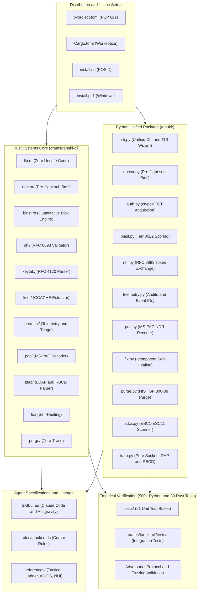

# Architecture

Tanuki ships two production-grade implementations that hold strict behavioral parity: an auditable Python reference engine and a standalone Rust systems core. Pick the engine that fits the host; the command surface, output, and exit codes are identical.

## Dual-engine comparison

| Feature / Metric | Python 3.10+ reference engine | Rust systems core (`tanuki-cli`) |
| :--- | :--- | :--- |
| **Primary focus** | Auditable reference, zero pip dependencies | Low latency, standalone security operations |
| **Binary / packaging** | Pure standard library (`tanuki/`) | 1.8 MB static musl binary (`crates/tanuki-cli/`) |
| **Execution latency** | ~42 ms (CPython VM startup) | ~0.76 ms (sub-millisecond native execution) |
| **Memory footprint** | ~14 MB RSS | ~1.1 MB RSS |
| **Host requirements** | Python 3.10+ runtime | None (standalone static ELF) |
| **Test verification** | 500+ unit tests (100% green) | 39 tests, library plus integration (100% green) |

## Core invariants

- **Living off the domain (zero dependencies).** The Python engine runs strictly on the 3.10+ standard library (`socket`, `struct`, `ctypes`, `hashlib`, `ssl`). No external pip packages.
- **Strictly unprivileged execution (UID 1000).** Runs entirely in userspace. Never requires `sudo`, root, or `CAP_SYS_TIME`.
- **Zero host mutation.** Never modifies `/etc/krb5.conf`, system PAM, or root system files. Configuration stays isolated to the calling process and its in-memory session.
- **Dual-engine parity.** Behavior is kept identical across the Python reference engine and the Rust core.
- **In-memory clock skew self-healing.** Calculates and compensates for KDC time drift in memory, without touching the system clock. Synthesized skew is clamped to the Kerberos standard 300 second maximum.
- **Quantitative blast radius engine.** Scores identity blast radius (0-100), classifies accounts into Active Directory tiers (Tier 0 / 1 / 2), and emits deterministic PowerShell mitigation recipes.
- **Cryptographic zero-trace purge.** Multi-pass zeroization (NIST SP 800-88) across process memory, credential caches, and session artifacts.

## Subsystem map



## Subsystem directory map

| Subsystem | Primary location | Key capabilities |
| :--- | :--- | :--- |
| **Rust systems core** | `crates/tanuki-cli/` | High-performance binary CLI built with `#![forbid(unsafe_code)]`. Houses sub-millisecond `doctor`, quantitative `blast`, RFC 8693 token exchange, RFC 4120 keytab parsing, MS-PAC NDR decoding, in-line RBCD parsing, and SSSD CCACHE extraction. |
| **Python unified package** | `tanuki/` | Zero-dependency PEP 621 package providing the `tanuki` entrypoint, native ctypes TGT acquisition, pre-flight diagnostics, self-healing `fix`, zero-trace `purge`, and unprivileged authenticated or anonymous LDAP queries. |
| **Living-off-the-land scripts** | `scripts/` | Standalone Python 3 standard library scripts for air-gapped environments without pip or a compiler toolchain. |
| **Agent skill definitions** | `SKILL.md`, `.cursor/rules/` | Multi-agent skill manifests auto-linked into Claude Code (`~/.claude/skills`), Cursor, and Google Antigravity. |
| **Technical references** | `references/` | Protocol manuals covering the decision ladder, the AD CS matrix (ESC1-ESC11), 15-code error triage, and NHI federation. |
| **Verification harness** | `tests/`, `crates/tanuki-cli/tests/` | 500+ Python unit tests and 39 Rust tests covering unit, boundary, pairwise, and live-wire lab scenarios. |

<details>
<summary><b>View complete directory file tree</b></summary>

```text
tanuki/
├── .github/
│   └── workflows/
│       ├── build-musl.yml     # Multi-architecture static musl binary builder
│       ├── ci.yml             # Push and PR test workflow
│       ├── pypi-publish.yml   # PyPI distribution workflow
│       └── release.yml        # Release asset and GHCR container packaging
├── assets/                    # Terminal validation proofs and branding
│   ├── 01_tanuki_doctor.png
│   ├── 02_tanuki_keytab.png
│   ├── 03_tanuki_auth_tgt.png
│   ├── 04_tanuki_blast_radius.png
│   ├── 05_dc01_event4769.png
│   ├── logo.png
│   ├── logo-dark.png
│   └── social-preview.png
├── crates/
│   └── tanuki-cli/            # Rust systems core
│       ├── Cargo.toml
│       ├── src/
│       │   ├── lib.rs         # Library entry point (#![forbid(unsafe_code)])
│       │   ├── main.rs        # CLI entry point and formatters
│       │   ├── adcs.rs        # Passive ADCS certificate scanner
│       │   ├── blast.rs       # Rust quantitative blast radius engine
│       │   ├── config.rs      # Zero-DNS krb5.conf generator
│       │   ├── fix.rs         # Closed-loop remediation engine
│       │   ├── ldap.rs        # Unprivileged LDAP and RBCD parser
│       │   ├── pac.rs         # MS-PAC and RBCD security descriptor decoder
│       │   ├── purge.rs       # NIST SP 800-88 cryptographic shredder
│       │   ├── shadow.rs      # msDS-KeyCredentialLink shadow credentials
│       │   ├── util.rs        # Entropy and JSON utilities
│       │   ├── doctor/        # Sub-millisecond pre-flight diagnostic probe
│       │   ├── nhi/           # RFC 8693 workload token validator
│       │   ├── keytab/        # RFC 4120 keytab binary parser
│       │   ├── kcm/           # SSSD KCM CCACHE stream extractor
│       │   └── protocol/      # Kerberos constants, error triage and telemetry
│       └── tests/
│           └── integration_tests.rs
├── tanuki/                    # Unified Python package (zero dependencies)
│   ├── __init__.py
│   ├── __main__.py
│   ├── adcs.py
│   ├── auth.py
│   ├── blast.py
│   ├── cli.py
│   ├── config.py
│   ├── doctor.py
│   ├── fix.py
│   ├── kcm.py
│   ├── keytab.py
│   ├── ldap.py
│   ├── nhi.py
│   ├── pac.py
│   ├── protocol.py
│   ├── purge.py
│   ├── shadow.py
│   └── telemetry.py
├── tests/                     # Python unit test suites
├── docs/                      # USAGE, VALIDATION, ARCHITECTURE
├── references/                # Protocol and tradecraft manuals
├── Cargo.toml                 # Root workspace manifest
├── pyproject.toml             # Python PEP 621 package specification
├── install.sh                 # 1-line POSIX installer (Linux and macOS)
└── install.ps1                # 1-line PowerShell installer (Windows)
```

</details>
