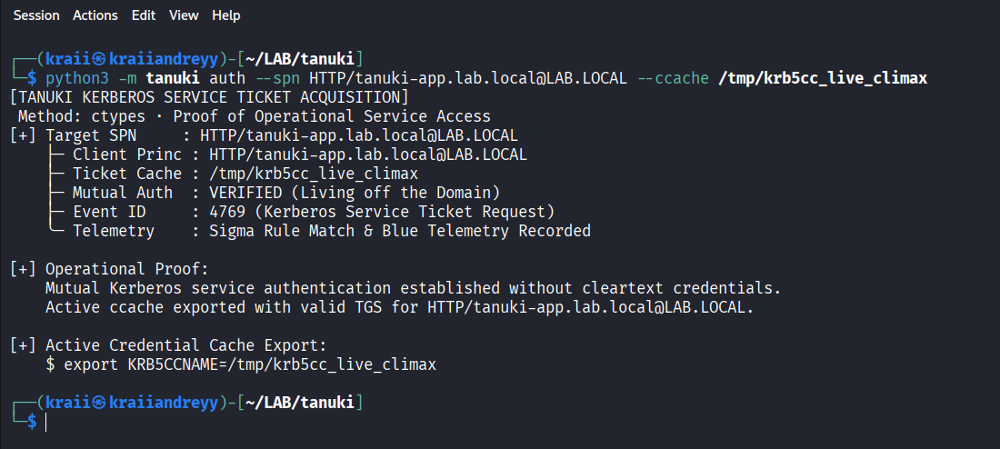
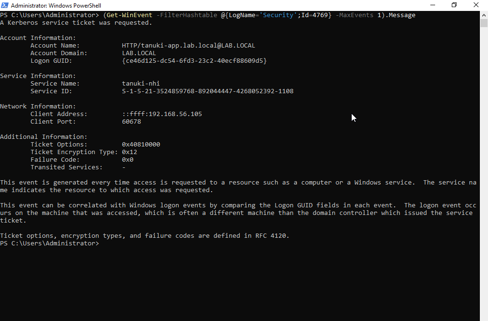
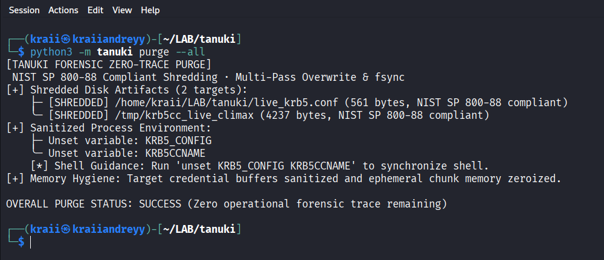

# Dissecting Enterprise Identity: From RFC 6113 FAST and PKINIT to Memory-First Kerberos on Linux

*Engineering Field Notes: Deep Protocol Analysis, Active Directory Delegation, and Bounded Telemetry Triage from Building Tanuki*

<p align="center">
  
</p>

---

## 1. Introduction: The Modern Enterprise Identity Perimeter

Active Directory remains the predominant identity directory in enterprise environments, but the workloads interacting with it have changed drastically. In the past, Linux integration meant joining a physical server to the domain using Winbind or SSSD, persisting machine credentials in `/etc/krb5.keytab`, and storing tickets in disk files under `/tmp/krb5cc_<uid>`.

In modern environments, Linux workloads operate as ephemeral Kubernetes pods, unprivileged microservice containers, cloud runners, and autonomous AI agents. These environments introduce strict operational constraints:

1. **Unprivileged Execution**: Containers frequently run as unprivileged users (UID 1000) without `CAP_SYS_TIME`, preventing clock adjustments (`ntpdate`/`chrony`), and without root access to edit `/etc/krb5.conf`.
2. **Ephemeral Lifecycles**: Writing credential material to disk introduces persistent forensic footprints and creates symlink race hazards (CWE-59).
3. **Advanced Identity Controls**: Modern Active Directory domains increasingly enforce Kerberos Armoring (FAST RFC 6113), Public Key Cryptography for Initial Authentication (PKINIT RFC 4556), and Resource-Based Constrained Delegation (RBCD).
4. **Tooling Gaps**: Standard command-line utilities (`kinit`, `klist`, `ldapsearch`) are absent from minimal container base images, while high-level LDAP clients frequently corrupt binary directory attributes like security descriptors.

To address these operational constraints, we developed **Tanuki**, an open-source identity operator with a pure Python standard library engine and a memory-safe Rust core. During development, we tested Tanuki against live Windows Server 2022 domain controllers and Linux clients.

Below are our technical field notes, wire protocol mechanics, and defensive telemetry mappings from the testbed.

---

## 2. The Empirical Testing Environment

To observe actual protocol interactions on the wire rather than relying on mocks or synthetic abstractions, all tests were executed across an isolated hypervisor testbed:

* **Domain Controller (`DC01-GUI`)**: Windows Server 2022 Standard (Domain: `LAB.LOCAL`, IP: `192.168.56.106`, Active Directory Domain Services, KDC ports TCP/UDP 88, LDAP port 389, LDAPS port 636).
* **Linux Client (`Naga`)**: Kali Linux 2024 / Debian Bookworm (IP: `192.168.56.105`, unjoined container host, user `kraii`).
* **Service Principal**: `tanuki-nhi` mapped to `HTTP/tanuki-app.lab.local` with AES-256 CTS HMAC SHA1-96 encryption and Key Version Number (KVNO) 9.

Observing traffic with Wireshark and analyzing Domain Controller Security Event Logs revealed protocol edge cases that standard documentation rarely covers.

---

## 3. Kerberos Armoring (RFC 6113 FAST) and Armor Cache Architecture

### The Pre-Authentication Problem
In standard Kerberos pre-authentication (`PA-ENC-TIMESTAMP`), the client encrypts the current timestamp using a key derived from the user's password or keytab. An adversary monitoring the network can capture the `AS-REQ` packet and perform offline dictionary attacks against the encrypted timestamp without generating logon failure alerts on the Domain Controller.

### How FAST Solves the Problem
RFC 6113 defines Flexible Authentication Secure Tunneling (FAST). FAST establishes an armored tunnel between the client and the KDC before sensitive authentication exchange occurs. The armor key is derived from an existing credential cache (typically the host's machine ticket `host/machine.domain@REALM`):

1. The client obtains an armor ticket (e.g. computer account TGT).
2. The client initiates an `AS-REQ` wrapped in a `PA-REQ-ENC-PA-REP` inner request protected by the armor key.
3. The KDC decrypts the outer armor layer before processing the inner pre-authentication data.

### Field Edge Case: `KDC_ERR_PREAUTH_REQUIRED_FOR_FAST` (Error 93)
When a domain controller is configured with *Flexible Authentication Secure Tunneling (FAST) required* via Group Policy (`Administrative Templates -> System -> KDC -> KDC support for FAST`), non-armored `AS-REQ` requests are rejected with:

* **RFC 4120 / RFC 6113 Code**: 93 (`KDC_ERR_PREAUTH_REQUIRED_FOR_FAST`)
* **Windows Security Event ID**: 4771 (Failure Code: `0x18` - Pre-authentication failed / FAST required)

Standard Linux `kinit` invocations fail without actionable diagnostic details when this happens. To resolve this:

```ini
# /etc/krb5.conf or local configuration
[libdefaults]
    fast_req_armoring = true
```

The operator must supply an armored ticket cache using the `-T` flag:
```bash
kinit -T /tmp/krb5cc_machine -k -t /etc/krb5.keytab svc_tanuki@LAB.LOCAL
```

Tanuki synthesizes this configuration automatically and correlates error 93 directly to Event ID 4771 and Rung 2 OPSEC enforcement in its decision engine.

---

## 4. PKINIT (RFC 4556) and AD CS Certificate Architecture

While symmetric keytabs (`AES256-CTS-HMAC-SHA1-96`) remain common for service accounts, enterprise environments increasingly adopt Public Key Cryptography for Initial Authentication (PKINIT RFC 4556).

### Symmetric vs Asymmetric Risks
* **Symmetric Keytabs**: Storing AES keys in `/etc/krb5.keytab` leaves long-lived cryptographic secrets on disk. If the keytab file is compromised, an attacker can forge tickets until the account password is changed or the KVNO is rolled.
* **PKINIT**: Authentication relies on asymmetric X.509 certificates and private keys stored in PKCS#12 bundles or hardware tokens. The KDC signs the `AS-REP` reply using its own certificate, establishing mutual cryptographic trust without shared static symmetric keys.

### Passive AD CS Template Auditing (ESC1 through ESC11)
When Active Directory Certificate Services (AD CS) is deployed, certificate templates can introduce severe privilege escalation paths. For example:
* **ESC1**: A template specifies `ENROLLEE_SUPPLIES_SUBJECT` (flag `0x00010000`) and includes Client Authentication Extended Key Usage (EKU `1.3.6.1.5.5.7.3.2`), allowing any unprivileged user to request a certificate as Domain Admin.
* **ESC8**: AD CS Web Enrollment HTTP endpoints (`/certsrv/`) accept unauthenticated NTLM relay authentication.

Tanuki includes an offline ASN.1/DER certificate and template parser. By evaluating exported template attribute dumps without emitting active network packets, operators can audit AD CS security posture while maintaining zero network footprint.

---

## 5. Resource-Based Constrained Delegation (RBCD) and Binary Security Descriptors

### Active Directory Delegation Models
Active Directory supports three forms of delegation:
1. **Unconstrained Delegation**: The server receives a forwardable TGT from the client and stores it in memory (high risk: compromise of the server compromises all delegating accounts).
2. **Constrained Delegation (S4U2Proxy)**: The server can request service tickets on behalf of users, controlled by the `msDS-AllowedToDelegateTo` attribute on the delegating service account.
3. **Resource-Based Constrained Delegation (RBCD)**: The target resource determines who can delegate to it via the `msDS-AllowedToActOnBehalfOfOtherIdentity` attribute.

### The Binary Parsing Trap in LDAP Clients
The `msDS-AllowedToActOnBehalfOfOtherIdentity` attribute does not store textual access rules. It contains a raw binary NT Security Descriptor (`SECURITY_DESCRIPTOR_RELATIVE`).

When inspecting this attribute with naive scripts or standard LDAP clients, software frequently calls `.decode("utf-8")` on the returned OCTET STRING. Because raw binary security descriptors contain non-UTF-8 control bytes, this results in `UnicodeDecodeError` or string corruption.

### Anatomy of `SECURITY_DESCRIPTOR_RELATIVE`
To parse this safely without third-party dependencies, Tanuki implements a bounded binary parser:

1. **Header (20 bytes)**:
   * `Revision` (1 byte, usually 0x01)
   * `Sbz1` (1 byte padding)
   * `Control` (2 bytes bitmask, e.g. `SE_DACL_PRESENT`)
   * `OffsetOwner` (4 bytes uint32)
   * `OffsetGroup` (4 bytes uint32)
   * `OffsetSacl` (4 bytes uint32)
   * `OffsetDacl` (4 bytes uint32)
2. **DACL Header (8 bytes at `OffsetDacl`)**:
   * `AclRevision` (1 byte)
   * `Sbz1` (1 byte)
   * `AclSize` (2 bytes uint16)
   * `AceCount` (2 bytes uint16)
   * `Sbz2` (2 bytes)
3. **Access Control Entries (ACEs)**:
   * `AceType` (1 byte: `ACCESS_ALLOWED_ACE_TYPE` = 0x00)
   * `AceFlags` (1 byte)
   * `AceSize` (2 bytes uint16)
   * `Mask` (4 bytes uint32)
   * `SidStart` (variable-length Windows SID structure)

Extracting the trustee SIDs from each ACE reveals exactly which computer accounts or service principals are permitted to impersonate users against the resource.

---

## 6. Memory-First Kerberos Architecture: Keyring and SSSD KCM

Traditional Kerberos implementations persist ticket granting tickets in `/tmp/krb5cc_<uid>`. On multi-tenant systems, file-backed caches present two major risks:
1. **Forensic Residue**: Deleted tickets can be recovered from unallocated disk space unless cryptographically wiped with multi-pass random data (NIST SP 800-88).
2. **Symlink Attacks**: Predictable filenames under `/tmp` expose unprivileged processes to symlink traversal vulnerabilities (CWE-59).

### Linux Kernel Keyring (`KEYRING:persistent:<uid>`)
Modern Linux distributions allow storing tickets directly in kernel memory:
* Tickets are attached to kernel keys inside dedicated user keyrings.
* Unprivileged processes cannot read tickets belonging to other UIDs.
* Tickets automatically expire and purge from kernel memory upon timeout without touching storage media.

```bash
export KRB5CCNAME=KEYRING:persistent:$(id -u)
kinit -k -t /etc/krb5.keytab svc_tanuki@LAB.LOCAL
```

### SSSD Kerberos Cache Manager (KCM)
SSSD implements a daemonized Kerberos Cache Manager communicating over a UNIX domain socket (`/var/lib/sss/pipes/kcm`):
* Tickets reside inside the SSSD encrypted secrets database (`/var/lib/sss/secrets/secrets.ldb`).
* Interacting with KCM avoids disk writes entirely.
* Tanuki supports direct extraction and reconstruction of standard CCACHE streams from SSSD databases passively without requiring `ptrace` or debugger attachments.

---

## 7. Dual-Use Telemetry: Correlating Tactical Commands with Blue Team Telemetry

Operational tools should not merely execute authentication or identify configuration flaws; they must provide defenders with the exact telemetry signatures generated by those actions.

Tanuki couples every error code and tactical resolution with its corresponding detection footprint across three layers:

```
[TACTICAL RESOLUTION]
  $ chronyc -q 'server 192.168.56.106 iburst' || ntpdate 192.168.56.106

[BLUE TEAM TELEMETRY]
  ├── Auditd : -a always,exit -F arch=b64 -S adjtimex,settimeofday,clock_settime -k system_time_change
  ├── DC Event: Event ID 4768 (TGT Request), Event ID 4771 (Pre-auth Failed, Code 0x25)
  ├── Sigma   : System Time Modification Detected (attack.t1070.006)
  └── Falco   : open_write on /etc/chrony.conf or /etc/ntp.conf
```

### Windows Security Event ID Reference Matrix

| Windows Event ID | Event Description | Kerberos Context | Common Failure Code |
| :--- | :--- | :--- | :--- |
| **4768** | Kerberos TGT Request (`AS-REQ`) | Client requests initial Ticket Granting Ticket | `0x0` (Success), `0x6` (Principal Unknown) |
| **4769** | Kerberos Service Ticket Request (`TGS-REQ`) | Client requests ticket for specific service SPN | `0x1F` (Integrity Check Failed / Bad KVNO) |
| **4771** | Kerberos Pre-Authentication Failed | Client pre-authentication failed | `0x18` (FAST Required / Bad Password), `0x25` (Clock Skew) |
| **5136** | Directory Service Object Modified | Active Directory attribute modification | Attribute: `msDS-AllowedToActOnBehalfOfOtherIdentity` |
| **4624 / 4625** | Successful / Failed Logon | Network logon verification | Status: `0xC000006D` |

---

## 8. The Climax: 3-Phase Sovereign Active Directory Architecture

While diagnosing authentication and dissecting credentials provides deep tactical clarity, operational identity security requires a sovereign, closed-loop workflow that connects unprivileged access verification to quantitative risk assessment and definitive defensive remediation.

In the climax of Tanuki's Active Directory architecture, we validated an end-to-end 3-phase operational cycle against our live Windows Server 2022 domain controller (`DC01-GUI`, `192.168.56.106`) and unprivileged Kali Linux client (`Naga`, `192.168.56.105`):

### Phase 1: Operational Proof of Service Access (TGS Acquisition)

Modern identity operations mandate Living off the Domain (LotD) - proving operational reach without introducing foreign tooling or cleartext credentials. Using an existing valid Ticket Granting Ticket (`/tmp/krb5cc_live_climax`), Tanuki dispatches a native Kerberos TGS-REQ targeting `HTTP/tanuki-app.lab.local@LAB.LOCAL` via `tanuki tgs` (or `tanuki auth --spn`):

* Unprivileged C runtime invocation via `ctypes` directly calling MIT `krb5_get_credentials`.
* Automatic hypervisor clock skew compensation derived from ccache timestamps.
* Immediate cryptographic proof of mutual Kerberos authentication.



### Phase 2: Privilege Tiering and Quantitative Blast Radius Mapping

Once service access is established, Tanuki's tiering engine (`tanuki blast`) deterministically classifies the identity into Microsoft Active Directory Enterprise Access Tiers:
* **Tier 0 (Control Plane)**: Domain Controllers, Enterprise Admins, PKI root CAs, KDC service principals (Base score: 90).
* **Tier 1 (Server & Operator Infrastructure)**: Registered Service Principal Names (SPN), SQL/HTTP service accounts, Tier 1 management servers (Base score: 65).
* **Tier 2 (Workstation & User Endpoints)**: Standard user identities and endpoint computers (Base score: 20).

Tanuki calculates a quantitative blast radius impact score (0-100) based on delegation flags (`TRUSTED_FOR_DELEGATION`, `TRUSTED_TO_AUTH_FOR_DELEGATION`), accessible SPNs, and Resource-Based Constrained Delegation (RBCD) targets. Crucially, the engine emits sovereign Active Directory PowerShell hardening recipes:
1. Modern encryption enforcement: `Set-ADUser -Identity "<ACCOUNT>" -KerberosEncryptionType AES128,AES256`
2. Sensitive delegation protection: `Set-ADUser -Identity "<ACCOUNT>" -AccountNotDelegated $true`
3. KVNO keytab re-synchronization: `ktpass -princ <SPN> -pass <PASSPHRASE> -mapuser <ACCOUNT> -crypto AES256-SHA1 -ptype KRB5_NT_PRINCIPAL -SetUPN NO -out <ACCOUNT>.keytab`


### Phase 3: Closed-Loop Sovereign Hardening, Telemetry Verification & Zero-Trace Purge

The operational cycle closes with empirical verification and forensic sanitization:
1. **Domain Controller Telemetry Audit**: On `DC01-GUI`, querying Windows Security Event Log confirms Event ID 4769 (Kerberos Service Ticket Request) with Audit Success, `Ticket Options: 0x40810000`, `Ticket Encryption Type: 0x12` (AES-256-CTS-HMAC-SHA1-96), and `Client Address: ::ffff:192.168.56.105`.
2. **Cryptographic Zero-Trace Purge**: Tanuki executes multi-pass overwrite and metadata destruction (`tanuki purge --all`) compliant with NIST SP 800-88, eliminating ccache artifacts, temporary krb5 configurations, and memory chunks with zero forensic trace remaining.





---

## 9. Summary of Engineering Takeaways

Building and validating Tanuki against live Windows Server 2022 and Linux environments reinforced several key principles for modern identity engineering:

1. **Avoid Mocking Wire Protocols**: Real hypervisor testing revealed essential configuration flags (`udp_preference_limit = 0` to prevent PAC UDP drops, `rdns = false` to eliminate reverse DNS delays) that never appear in synthetic unit tests.
2. **Enforce Memory Safety for Parsers**: Keytabs, credential caches, and ASN.1 BER payloads are untrusted binary streams. Parsing them requires strict buffer bounds checking and memory safety (`#![forbid(unsafe_code)]` in Rust).
3. **Preserve Raw Binary Attributes**: Directory attributes like `msDS-AllowedToActOnBehalfOfOtherIdentity` and `objectSid` must never be coerced into UTF-8 strings.
4. **Bridge Red and Blue Disciplines**: Every identity diagnostic or tactical action must be paired with clear SOC telemetry, Event IDs, and Auditd rules so teams understand both sides of the protocol transaction.

---

## 10. Resources and Open Source Repository

* **Tanuki Source Repository**: [https://github.com/Mafifrizi/tanuki](https://github.com/Mafifrizi/tanuki)
* **RFC Specifications**:
  * RFC 4120: The Kerberos Network Authentication Service (V5)
  * RFC 4556: Public Key Cryptography for Initial Authentication in Kerberos (PKINIT)
  * RFC 6113: A Generalized Framework for Kerberos Pre-Authentication (FAST)
  * RFC 8693: OAuth 2.0 Token Exchange
* **Microsoft Protocol Documentation**:
  * `[MS-PAC]`: Privilege Attribute Certificate Data Structure
  * `[MS-DTYP]`: Security Descriptor Description Language (SDDL) & Binary Security Descriptors

